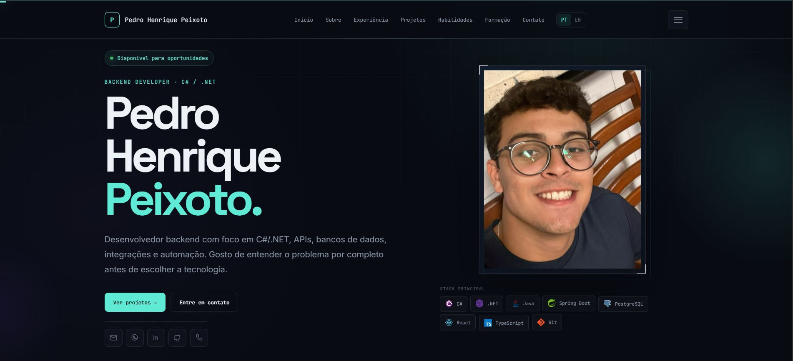

# Pedro Henrique Peixoto — Portfolio

Personal portfolio built with React + Vite, featuring a real-time infrastructure panel powered by a Vercel Serverless API, PostgreSQL/Supabase and GitHub API integration.

The portfolio goes beyond a static presentation: the infrastructure panel consumes real API endpoints, executes database operations and displays live request activity.

## Tech Stack

- React
- Vite
- JavaScript
- Node.js
- Vercel Serverless Functions
- PostgreSQL
- Supabase
- GitHub API

## Project Structure

```text
pedro-portfolio/
├── api/
│   ├── activity.js
│   ├── github.js
│   ├── health.js
│   └── projects.js
├── db/
│   └── schema.sql
├── public/
├── src/
├── index.html
├── package.json
└── vite.config.js
## Motion

The page motion comes from the client sites built with the same method (DJ Auto Center, Thiago Bike, Aluizio Bicicletas), in the portfolio's own palette:

| Effect | Where |
| --- | --- |
| Intro: the `{ P }` monogram draws itself, then the curtain lifts (once per tab, never with reduced motion) | `src/components/Intro.jsx` |
| Smooth scroll (Lenis), sheets that slide over each other, reveals, parallax, progress bar | `src/hooks/useMotion.js`, `src/motion.css` |
| Masked headline in the hero | `Hero.jsx`, `.mask` in `motion.css` |
| Two meshing gears that turn with the scroll speed | `src/components/Gears.jsx`, `useSpin` in `src/hooks/useScrollFx.js` |
| Manifesto: one sentence lights up word by word | `src/components/Manifesto.jsx`, `useScrubWords` |
| "One request, end to end": a pinned blueprint where a packet crosses CLIENT, API, SERVICE and DATABASE | `src/components/Journey.jsx`, `useSceneProgress` |
| Route meter fixed at the bottom: the same packet crosses the stack as the page is read | `src/components/RouteWidget.jsx` |

Everything is drawn in SVG and CSS; the only new dependency is `lenis`. With `prefers-reduced-motion` nothing moves and the scenes show their final state.
